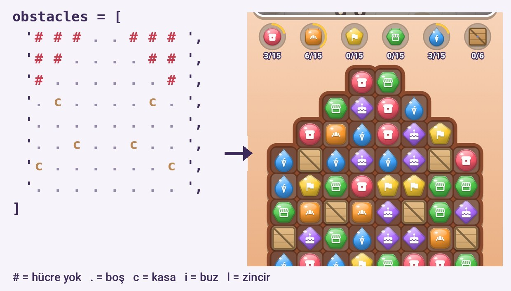
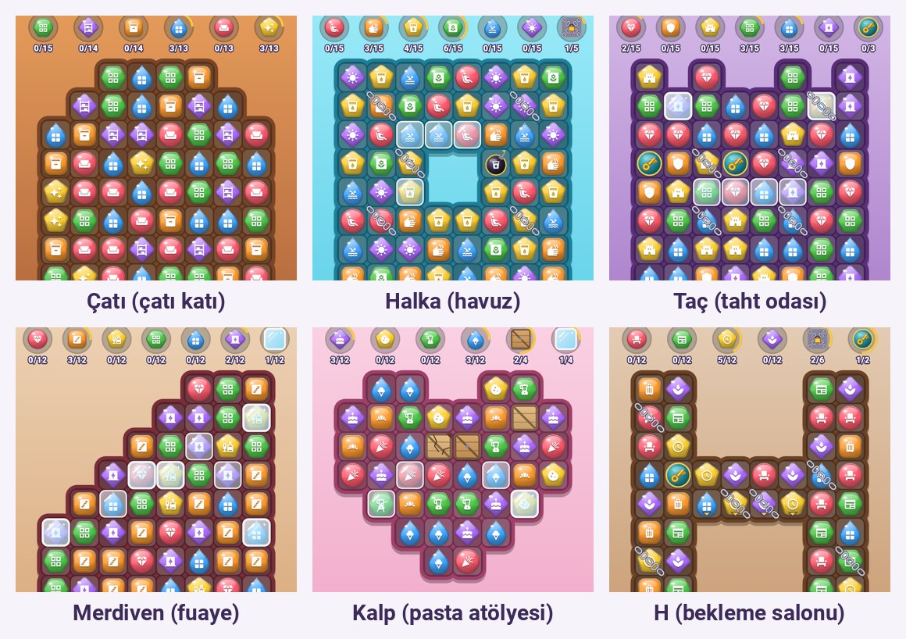
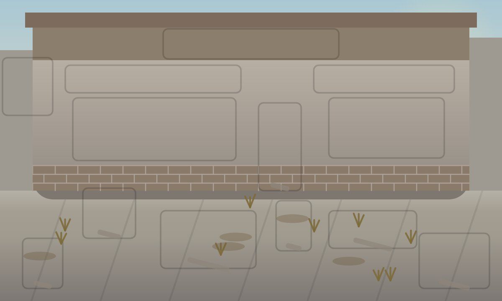
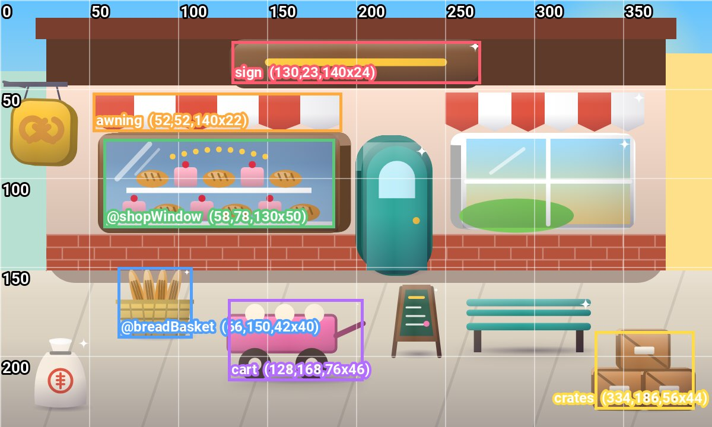
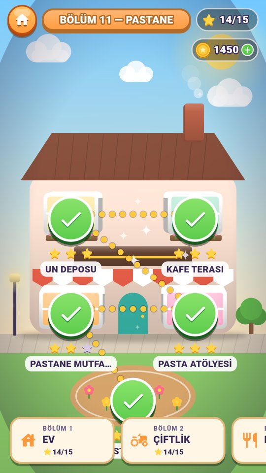

# Match Make — Seviye Rehberi

Bu rehber, oyuna yeni seviye ve bölüm eklemeyi ya da var olanları değiştirmeyi anlatır.
Kod bilmeden de takip edilebilir: seviyeler bir "tarif" dosyasında yazılır, bir araç bu
tarifi oyunun kodlarına çevirir.

## 1. Bir seviye nelerden oluşur?

| Parça | Ne işe yarar |
|---|---|
| **Tahta** | 8×8 ızgara. `#` ile hücre silinerek şekil verilir, üzerine kasa/buz/zincir konur |
| **Taşlar** | Seviyede düşen 6 taş türü (her biri farklı renk ve şekil) |
| **Hedefler** | "15 kruvasan topla", "6 kasa kır", "2 anahtar indir" gibi 5–7 görev |
| **Hamle** | Oyuncunun kaç hamlesi olduğu |
| **Yıldızlar** | 2 ve 3 yıldız için gereken puan |
| **Sahne** | Tahtanın üstünde görünen, hedefler toplandıkça yenilenen resim |
| **Tema** | Arka plan, tahta çerçevesi ve vurgu renkleri |

## 2. Tahta: yazdığın şey → oyunda gördüğün şey



Her satır tam 8 karakterdir, toplam 8 satır yazılır:

| Karakter | Anlamı |
|---|---|
| `.` | Normal hücre |
| `#` | **Hücre yok** — tahtaya şekil verir. Taşlar boşluğun içinden aşağı düşer |
| `c` `C` `B` | Kasa (1, 2, 3 vuruşta kırılır). Üzerinde taş olmaz, yanında eşleştirme yapınca hasar alır |
| `i` `I` | Buz (1 veya 2 kat). Üstündeki taş patlayınca çatlar |
| `l` `L` | Zincir (1 veya 2 kat). Zincirli taş yer değiştiremez |
| `j` `J` | Buz + zincir birlikte |

Kurallar: şekil tek parça olmalı (kopuk adacık olmaz) ve en az 40 hücre kalmalı.
Engeller `#` üzerine konamaz.

### Şekil örnekleri (oyundan gerçek görüntüler)



```
Çatı         Halka        Taç          Kalp         H            Merdiven
##....##     ........     .#.##.#.     #..##..#     ...##...     #####...
#......#     ........     ........     ........     ...##...     ####....
........     ........     ........     ........     ...##...     ###.....
........     ...##...     ........     ........     ........     ##......
........     ...##...     ........     ........     ........     #.......
........     ........     ........     #......#     ...##...     ........
........     ........     ........     ##....##     ...##...     ........
........     ........     ........     ###..###     ...##...     ........
```

**Zorluk ipucu:** Hücre azaldıkça hamle başına toplanan taş azalır. Dar boğazlı şekillerde
(kum saati gibi) hedefleri düşür veya hamle ekle.

## 3. Hedefler ve taşlar

```python
tiles=['b1_croissant', 'cabinets', 'table', 'herbs', 'fridge', 'decor_cup'],
objectives=[
    ('b1_pastries', 'b1_croissant', 15),   # 15 kruvasan taşı topla
    ('crates',      'crate',         6),   # 6 kasa vuruşu
    ('ice',         'ice',           4),   # 4 buz katı
    ('gates',       'key',           2),   # 2 anahtar indir (anahtarlar kendiliğinden gelir)
],
```

- 6 taşın renk/şekil "slotları" 0'dan 5'e kadar birer kez kullanılmalı (araç kontrol eder).
  Var olan bütün taşlar ve slotları `tool/content/existing.json` içinde.
- Engel hedefi, tahtadaki toplam engelden fazla olamaz (araç kontrol eder).
- Hedef adının ekranda görünen ismi `NEW_OBJECTIVES` içinde Türkçe/İngilizce yazılır.

## 4. Sahne: eşyaları yerleştirmek

Sahne alanı **400 × 240** birimdir. Her eşya `(tür, x, y, genişlik, yükseklik, renk1, renk2)`
ile yerleştirilir. Her hedefe 1–3 eşya bağlanır; hedef toplandıkça eşyalar sırayla belirir.

Önce (harap) ve sonra (yenilenmiş) hâli:




```python
scene=dict(
    backdrop=_outdoor,                   # dış mekân / iç mekân arka planı
    props=[
        ('b1_pastries', [('@shopWindow', 58, 78, 130, 50, '_wood', '_cream')]),
        ('crates',      [('crates', 334, 186, 54, 40, '_wood', '_gold')]),
    ],
),
```

- **Hazır eşyalar** (`lib/ui/scenes/prop_kit.dart`, ~125 adet): `tree`, `palm`, `bush`, `fence`,
  `fountain`, `statue`, `lamppost`, `bench`, `table`, `chair`, `sofa`, `bed`, `window`,
  `curtains`, `painting`, `bookshelf`, `counter`, `stove`, `fridge`, `piano`, `chandelier`,
  `plant`, `crates`, `barrel`, `cart`, `sign`, `awning`, `stairs`, `clock`, `vase` …
- **Özel eşyalar** `@` ile başlar (`@shopWindow` gibi) ve tarif dosyasının `DART` bölümünde
  küçük bir çizim fonksiyonu olarak yazılır (kutu, daire, renk geçişi). Örnek:
  `tool/content/spec_example.py`.
- İç mekânda zemin çizgisi y≈172, dış mekânda y≈140–150: yere duran eşyaların alt kenarı
  bu çizginin altında olmalı. Duvara asılanlar üst bölgeye.
- Gölge ve ışık otomatik eklenir.

## 5. Bölüm haritası



Her bölümün dikey (360×640) bir haritası vardır: binalar `lib/ui/scenes/maps_b<N>.dart`
içinde çizilir, 5 seviye düğmesi (`MapSpot`) binaların pencerelerine ya da bahçeye konur.
Seviye tamamlandıkça o bölge yenilenir. Örnek: `tool/content/maps_example.dart.txt`.

## 6. Var olan bir seviyeyi değiştirmek (en kolay iş)

- **Seviye 1–50:** `lib/data/content/house_chapter.dart`, `farm_chapter.dart` … dosyalarında
  her seviye bir blok hâlinde durur. `moves:`, `target:`, `obstacles:` satırlarını değiştir.
- **Seviye 51–75:** `tool/content/spec_b1.py`. Son hamle/hedef/yıldız ayarları dosyanın
  sonundaki **`TUNE`** bölümündedir:
  ```python
  'bakery_front': dict(moves=28, stars=(22500, 34000)),
  ```
  Değiştirdikten sonra `python3 tool/content/gen_batch.py 1` çalıştırılır.

## 7. Yeni bölüm eklemek

1. `tool/content/spec_example.py` dosyasını örnek al: 1 bölüm = 5 seviye
   (her seviye: tahta, taşlar, hedefler, sahne, isim, tema).
2. Kendi grubunun tarif dosyasına ekle (`spec_b<N>.py`); bölüm numarası ve önceki bölüm
   (`PREV_CHAPTER`) zinciri bozulmamalı.
3. Haritayı `maps_b<N>.dart` içine ekle.
4. `python3 tool/content/gen_batch.py <N>` → hata yoksa dosyalar üretilir.

## 8. Denemek

```bash
python3 tool/content/gen_batch.py 1                          # tarifi kontrol et + üret
flutter test test/level_balance_test.dart --name "level 51 "  # bot seviyeyi 100 kez oynar
flutter test --dart-define=MM_HIDE_DEBUG=true --dart-define=BATCH=1 tool/content/render_batch_test.dart
python3 tool/content/contact_sheet.py 1                     # sahne+harita+tahta özet resmi
flutter run                                                  # telefonda oyna
```

Bot testi şunu yazar: `51 bakery_front: win 60% score p50=22500 p90=34000`.
- **win** seviyenin `floor` değerinin (ör. 0.54) üstünde olmalı. Altındaysa hamle ekle veya
  hedef azalt; çok üstündeyse (> +0.20) zorlaştır.
- **Yıldızlar:** 2 yıldız ≈ p50, 3 yıldız ≈ p90 (500'e yuvarla).

## 9. GitHub'a eklemek

**Kural: kendi dalını aç, ana dala (`claude/projeyi-incele-12280x`) doğrudan gönderme.**

Tarayıcıdan (küçük değişiklik):
1. GitHub'da dosyayı aç → kalem simgesi → değiştir.
2. "Commit changes" → **Create a new branch** → dal adı ver (ör. `faruk-seviye-ayari`).
3. Haber ver; kontrol edilip testlerden geçirilerek birleştirilir.

Bilgisayardan:
```bash
git clone https://github.com/Civelek1/match-make.git && cd match-make
git checkout claude/projeyi-incele-12280x
git checkout -b faruk-yeni-bolum
# düzenle → gen_batch.py → testler
git add -A && git commit -m "Yeni bölüm: ..." && git push -u origin faruk-yeni-bolum
```
