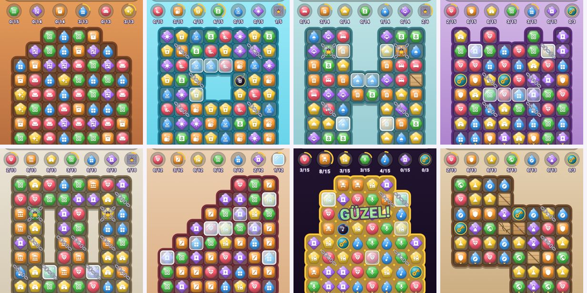
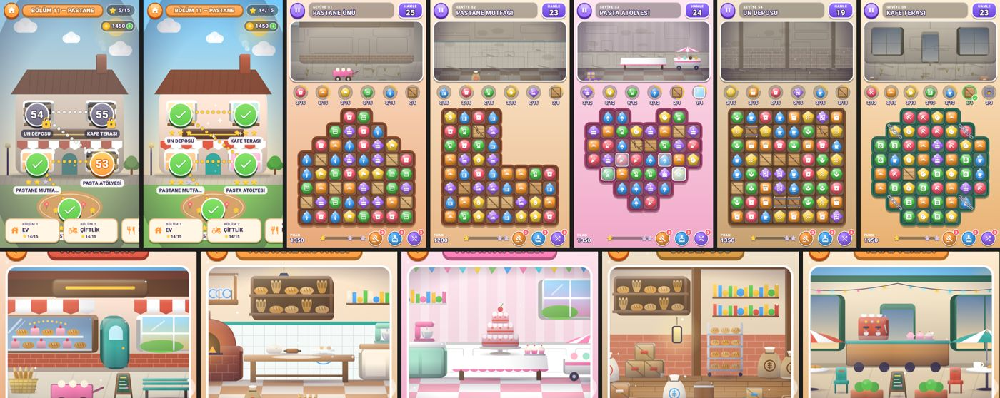
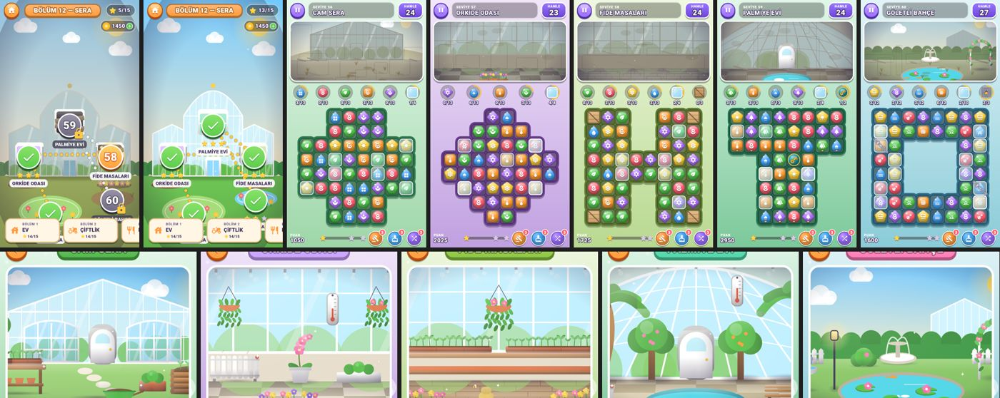
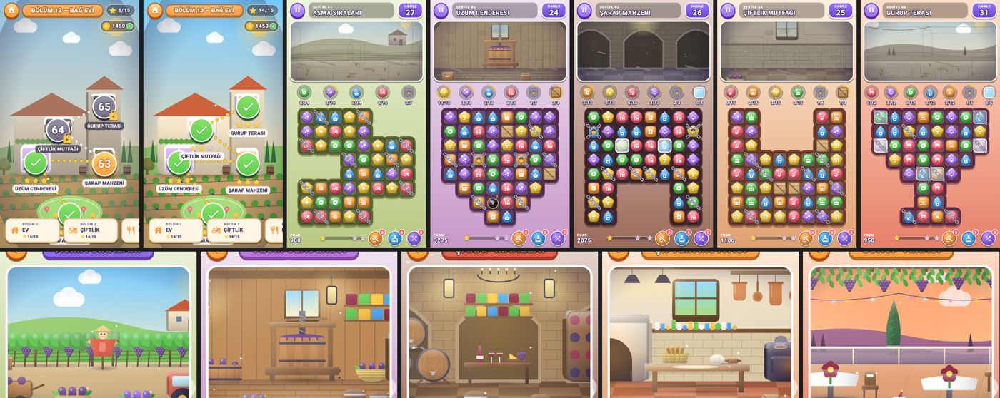
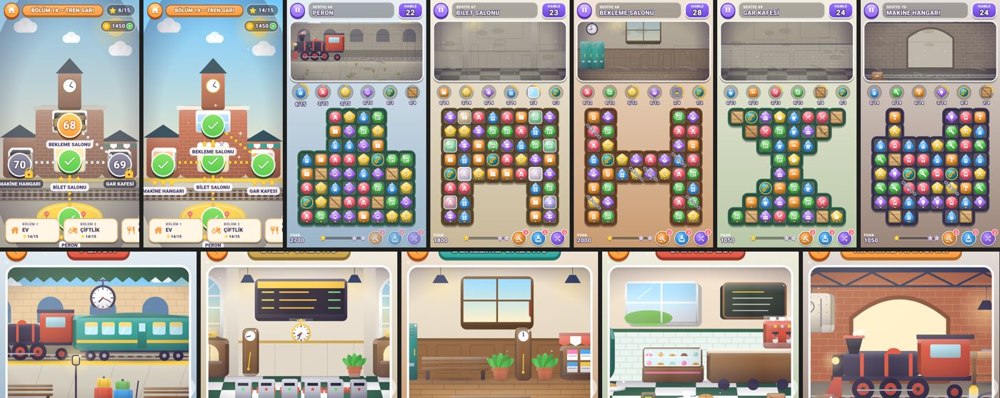
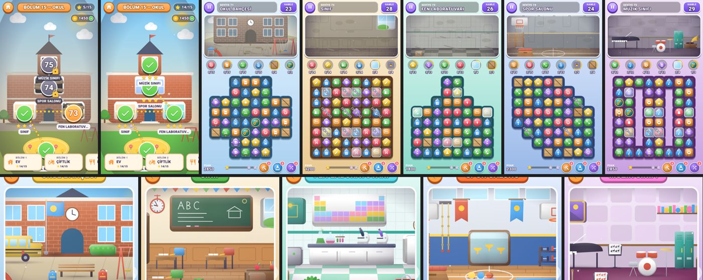

# Match Make — Yenilikler

Son güncellemede gelenlerin özeti. Görseller oyundan alınmış gerçek ekranlardır.

## 1. Şekilli tahtalar

Tahtalar artık her zaman düz 8×8 kare değil. Bazı hücreler tahtadan çıkarılarak L, U, T,
artı, halka, kalp, merdiven, taç gibi şekiller oluşturuluyor.

- Taşlar ve anahtarlar boşlukların içinden aşağı düşer.
- Tahta çerçevesi şekli takip eder; boşluklara dokunulamaz.
- Her şekil farklı bir strateji ister: dar boğazlar, ayrı odalar, köşeler…

## 2. İlk 50 seviyeden 20'si yeniden şekillendi

Şekiller mekâna uygun seçildi: çatı katı çatı biçiminde, havuz halka, otel odası H,
taht odası taç, heykel salonu sütunlu, fuaye merdiven, büyük sahne sahne kemeri…
Hedefler ve hamleler test botuyla yeniden ayarlandı; zorluk eski aralıkta kaldı.
1–4. seviyeler ve yeni mekanik tanıtan seviyeler bilerek düz bırakıldı.

## 3. 25 yeni seviye (51–75), 5 yeni bölüm

Her bölümde 5 seviye, her seviyenin kendine özel yenilenen sahnesi ve her bölümün kendi
haritası var. Her bölümün en az 4 seviyesi şekilli tahta kullanıyor ve bölümlerin
"imza" engeli farklı.

Aşağıdaki resimlerde üst sırada bölüm haritası (yarım ve tam yenilenmiş) ile 5 seviyenin
tahtası, alt sırada 5 seviyenin yenilenmiş sahnesi görünüyor.

### Bölüm 11 — Pastane (imza engel: kasa)
Pastane önü, mutfak, pasta atölyesi, un deposu, kafe terası. Şekiller: piramit, L, kalp, sekizgen.

### Bölüm 12 — Sera (imza engel: buz)
Cam sera, orkide odası, fide masaları, palmiye evi, göletli bahçe. Şekiller: artı, elmas, çift oda, T, halka.

### Bölüm 13 — Bağ Evi (imza engel: zincir)
Asma sıraları, üzüm cenderesi, şarap mahzeni, çiftlik mutfağı, gurup terası. Şekiller: zikzak, huni, kemer, kupa, kadeh.

### Bölüm 14 — Tren Garı (imza engel: anahtar)
Peron, bilet salonu, bekleme salonu, gar kafesi, makine hangarı. Şekiller: U, kemer, H, kum saati, lokomotif.

### Bölüm 15 — Okul (karışık)
Okul bahçesi, sınıf, fen laboratuvarı, spor salonu, müzik sınıfı. Şekiller: artı, şişe, çapraz, sütunlar.

## 4. Diğer değişiklikler

- **Yeni testler:** Şekilli tahtalar için 6 yeni test eklendi. Oyunda toplam 164 otomatik test var, hepsi geçiyor.
- **Seviye rehberi:** Seviye ve bölüm eklemeyi resimlerle anlatan rehber eklendi: [SEVIYE_REHBERI.md](SEVIYE_REHBERI.md).
- **Mağaza metinleri:** Yeni içeriğe göre güncellendi.

## 5. Sırada ne var

76–150. seviyeler (15 bölüm) büyük ölçüde hazırlandı ve yedek dallarda duruyor:

| Seviyeler | Bölümler | Durum |
|---|---|---|
| 76–100 | Hayvanat Bahçesi, Akvaryum, Lunapark, Kitapçı, Gözlemevi | Son kontroller |
| 101–125 | Japon Bahçesi, Orman Kampı, Sirk, Çöl Vahası, Korsan Gemisi | Çizimler yarıda |
| 126–150 | Buz Sarayı, Kaplıca, Uzay Üssü, Büyük Otel, Saray (final) | Son kontroller |
